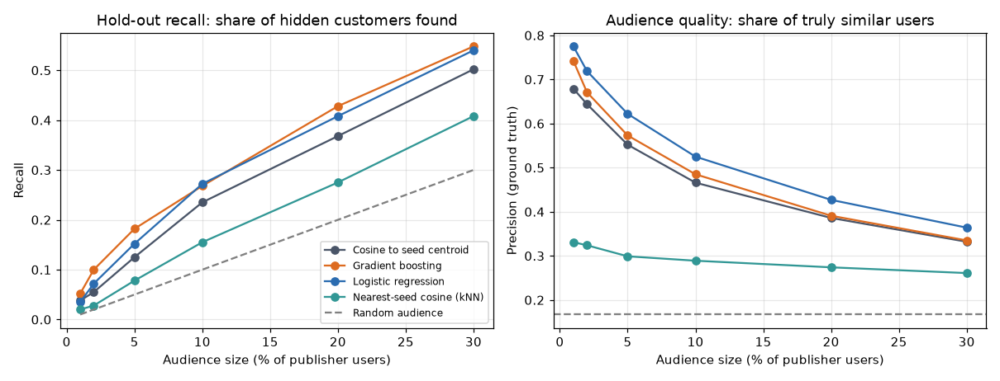
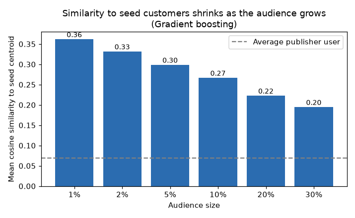

# Lookalike audience evaluation without labels (Python)


[](https://github.com/alex-sukhoi/lookalike-audience-evaluation/actions/workflows/reproduce.yml)

A publisher builds **lookalike audiences** for advertisers: the advertiser uploads its customers,
a model trained on the publisher's user embeddings scores every reader, and the advertiser picks an
audience size (top 1%, 5%, 10%, ...). The advertiser then asks:

- What does it mean for an audience to be "more similar" or "less similar"?
- Would a different model give a more similar audience?
- **How much less similar does the audience get as it grows?**

The catch: publisher users are **unlabelled**. Nobody knows who is a true negative, so accuracy, ROC
or precision cannot be computed on the inference data. This project gives answers that are
**interpretable, statistically sound and automatable**.

> **Data:** synthetic. 60,000 publisher users and 2,000 advertiser customers with 32-dimensional
> interest embeddings (`src/lookalike.py`). Because the data are simulated, the true lookalikes are
> known, so the label-free metrics can be checked against the truth.

## Method

1. **Seed hold-out recall (label-free).** Hide 20% of the advertiser's customers, mix them into the
   inference pool, score everyone, and measure the share of hidden customers that each audience cut
   recovers. **Lift = recall@k / k** shows how much better than a random audience the model is.
2. **Similarity profile.** For every cut, report the mean cosine similarity to the seed customers'
   centroid. This is a plain-language answer to "how alike are they?".
3. **Models compared:** cosine to the seed centroid, nearest-seed cosine (kNN), logistic regression,
   and gradient boosting. The classifiers are trained on seed users vs a sample of publisher users
   treated as unlabelled.
4. **Validation against ground truth:** does the label-free metric rank the models the same way as
   the true precision does?

## Results

<p align="center"></p>

**Model ranking at a 5% audience (3,020 users):**

| Model | Hold-out recall | Lift vs random | True share of lookalikes |
|---|---|---|---|
| Gradient boosting | 18.2% | 3.6× | 57% |
| Logistic regression | 15.2% | 3.0× | 62% |
| Cosine to seed centroid | 12.5% | 2.5× | 55% |
| Nearest-seed cosine (kNN) | 7.8% | 1.6× | 30% |

For comparison, 16.7% of all publisher users are true lookalikes.

<p align="center"></p>

### Answers to the advertiser's questions

- **"How similar is my audience?"** Report lift and mean similarity per cut. A 1% audience from the
  best model is 5× better than random. At 30% it is only 1.8× better.
- **"Which model?"** The trained classifiers (gradient boosting, logistic regression) beat
  similarity-only rules. Nearest-seed kNN is close to random because single noisy seeds pull in
  unrelated users.
- **"How much do I lose by going bigger?"** The share of true lookalikes falls from about 75% in the
  top 1% to about 35% in the top 30%. Mean similarity drops steadily with size. Every extra slice of
  audience is less like the customers than the one before.
- **Can the label-free metric be trusted?** Its model ranking agrees with the ground-truth ranking
  (Spearman 0.8–1.0 for audiences of 2–30%). It is less stable at 1%, where only a few hidden
  customers fall into the cut, so larger hold-outs are needed for very small audiences.

### Practical recommendations

- Run several hold-out splits and report recall with a confidence interval.
- Expose a **lift-by-size curve** to advertisers instead of a single score.
- For segment (one-hot) data, the same protocol works with Jaccard similarity in place of cosine.

## Repository structure

```
src/lookalike.py   data simulation, models, evaluation, figures
results/           audience quality by size, model ranking, metric-vs-truth agreement
figures/           recall/precision curves, similarity decay
```

## How to run

```bash
pip install -r requirements.txt
python src/lookalike.py
```

## References

- Liu, H., Pardoe, D., Liu, K., Thakur, M., Cao, F., & Li, C. (2016). Audience expansion for online social network advertising. *Proceedings of the 22nd ACM SIGKDD Conference*, 165–174.
- Bekker, J., & Davis, J. (2020). Learning from positive and unlabeled data: A survey. *Machine Learning, 109*(4), 719–760.

---
**Author:** [Oleksii Sukhoi](https://github.com/alex-sukhoi), statistician and data analyst · [LinkedIn](https://www.linkedin.com/in/oleksii-sukhoi-4b60161a7)
